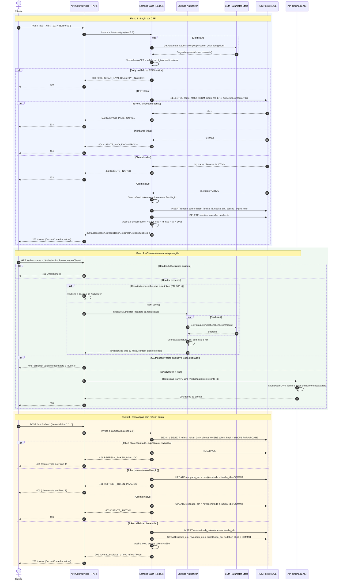

# Fluxo de autenticação por CPF

Este documento define como o cliente da oficina se autentica pelo CPF e como renova a sessão com um refresh token. Também descreve o que vai dentro do token, como as rotas protegidas o validam e onde fica a chave de assinatura. Fecha com o diagrama de sequência dos fluxos.

| Item | Decisão |
|---|---|
| Tipo de API Gateway | **HTTP API** (API Gateway v2) |
| Rotas de autenticação | `POST /auth` (login por CPF), `POST /auth/refresh` (renovação) e `POST /auth/logout` (encerrar sessão), todas atendidas pela mesma Lambda |
| Access token | JWT **HS256**, validade de **15 minutos** |
| Refresh token | Valor **opaco e aleatório**, guardado como hash no RDS. Validade de **7 dias**, renovada a cada uso até o limite de **30 dias** de sessão. É **trocado a cada uso**, com detecção de reutilização |
| Identificação no token | `sub` = id interno do cliente. **Sem CPF e sem hash do CPF** |
| Validação nas rotas protegidas | **Lambda Authorizer** no HTTP API, mantendo a validação que a API no EKS já faz (defesa em profundidade) |
| Chave de assinatura | **SSM Parameter Store** (`SecureString`), lida pela Lambda no cold start |

---

## 0. HTTP API ou REST API

O [ADR-002](adr/ADR-002-localizacao-terraform-lambda-api-gateway.md) já adota o **HTTP API**. Para este caso ele é a escolha certa:

| Critério | HTTP API | REST API |
|---|---|---|
| Custo | ~70% mais barato por requisição | Mais caro |
| Latência | Menor | Maior |
| Lambda Authorizer | Sim, com resposta simples (`isAuthorized`) e cache | Sim (retorna uma policy IAM) |
| JWT Authorizer nativo | Sim | Não (só Cognito ou Lambda) |
| Integração privada com o EKS | VPC Link para ALB, NLB ou Cloud Map | VPC Link só para NLB |
| Throttling por rota | Sim | Sim, e também usage plans e API keys |
| WAF, cache de resposta, validação de schema, respostas de erro customizadas | Não | Sim |

Nenhum recurso exclusivo do REST API é necessário aqui. A falta de **respostas de erro customizadas** é a única limitação que aparece: os erros gerados pelo próprio gateway (401, 403, 429, 503) vêm sempre no formato `{"message": "..."}`, diferente do formato de erro da Lambda (seção 1.4).

---

## 1. Contrato da Lambda de autenticação

Uma única Lambda atende as três rotas e decide o que fazer pelo `event.routeKey` (`POST /auth`, `POST /auth/refresh` e `POST /auth/logout`). Nenhuma dessas rotas passa pelo Lambda Authorizer.

### 1.1 `POST /auth` — login por CPF

```http
POST /auth
Content-Type: application/json

{
  "cpf": "123.456.789-09"
}
```

| Campo | Tipo | Regra |
|---|---|---|
| `cpf` | string | Obrigatório. Aceita com máscara (`123.456.789-09`) ou só os dígitos (`12345678909`). A Lambda remove tudo que não for dígito antes de validar. |

Validação do CPF, feita **antes** de consultar o banco:

1. após remover a máscara, deve ter exatamente 11 dígitos;
2. não pode ter todos os dígitos iguais (`00000000000`, `11111111111`, ...);
3. os dois dígitos verificadores devem bater com o cálculo módulo 11.

A consulta usa o CPF normalizado, só com dígitos. A coluna `numerodocumento` da tabela `cliente` já é gravada nesse formato pelo value object `Documento` da API, e guarda CPF (11 dígitos) ou CNPJ (14 dígitos):

```sql
SELECT id, nome, status FROM cliente WHERE numerodocumento = $1 ORDER BY id LIMIT 1;
```

O esquema mínimo que a Lambda usa (tabela criada pela API em `database/init/01_schema.sql`):

| Coluna | Tipo | Origem |
|---|---|---|
| `id` | `SERIAL` (integer) | API |
| `nome` | `varchar(50)` | API |
| `numerodocumento` | `varchar(14)`, só dígitos | API |
| `status` | `varchar(20) NOT NULL DEFAULT 'ATIVO'`, com `CHECK` em `ATIVO`, `INATIVO` ou `BLOQUEADO` | Migration `db/migrations/V001__cliente_status.sql` deste repositório |

Só o status `ATIVO` autentica. `INATIVO`, `BLOQUEADO` ou qualquer valor desconhecido resultam em `403 CLIENTE_INATIVO`. A tabela não tem `UNIQUE` em `numerodocumento`: se houver duplicidade, vale o registro de menor `id`.

Se o cliente estiver ativo, a Lambda abre uma **nova sessão**:

1. gera um `familia_id` novo;
2. grava o hash do refresh token na tabela `refresh_token` (seção 2.4);
3. aproveita para apagar as sessões vencidas desse mesmo cliente;
4. responde com o par de tokens:

```http
HTTP/1.1 200 OK
Content-Type: application/json
Cache-Control: no-store

{
  "accessToken": "eyJhbGciOiJIUzI1NiIsInR5cCI6IkpXVCJ9...",
  "tokenType": "Bearer",
  "expiresIn": 900,
  "refreshToken": "q3M1x9oK7cVd2bN8rT0yWfE5hJ4uA6sZ1gL0pXcVb2E",
  "refreshExpiresIn": 604800
}
```

| Campo | Descrição |
|---|---|
| `accessToken` | JWT assinado (claims na seção 2.2). Vai no header `Authorization: Bearer <accessToken>` das rotas protegidas |
| `tokenType` | Sempre `Bearer` |
| `expiresIn` | Validade do access token em segundos |
| `refreshToken` | Valor opaco usado **somente** em `/auth/refresh` e `/auth/logout`. Nunca vai para as rotas protegidas |
| `refreshExpiresIn` | Validade do refresh token em segundos. Pode ser menor que 7 dias perto do limite absoluto de 30 dias da sessão |

O `Cache-Control: no-store` impede que proxies ou o navegador guardem os tokens em cache.

### 1.2 `POST /auth/refresh` — renovação da sessão

```http
POST /auth/refresh
Content-Type: application/json

{
  "refreshToken": "q3M1x9oK7cVd2bN8rT0yWfE5hJ4uA6sZ1gL0pXcVb2E"
}
```

Em caso de sucesso, a Lambda devolve `200` com um **novo** `accessToken` e um **novo** `refreshToken`, no mesmo formato do login. O refresh token enviado deixa de valer na hora (seção 2.4).

A cada renovação o **status do cliente é conferido de novo**. Um cliente inativado perde o acesso em no máximo 15 minutos, quando o access token atual vencer.

### 1.3 `POST /auth/logout` — encerrar a sessão

```http
POST /auth/logout
Content-Type: application/json

{
  "refreshToken": "q3M1x9oK7cVd2bN8rT0yWfE5hJ4uA6sZ1gL0pXcVb2E"
}
```

A Lambda revoga **toda a família** do refresh token, ou seja, a sessão inteira. Ela responde `204 No Content` sem corpo, **mesmo que o token não exista ou já esteja revogado**. Assim a operação é idempotente e não revela se o token era válido.

O access token já emitido continua valendo até expirar, no máximo 15 minutos. O cliente deve descartá-lo localmente.

### 1.4 Respostas de erro

Todas as respostas de erro da Lambda seguem o mesmo formato:

```json
{
  "code": "CPF_INVALIDO",
  "message": "O CPF informado é inválido.",
  "requestId": "c6af9ac6-7b61-11e6-9a41-93e8deadbeef"
}
```

- `code`: identificador estável, para o cliente tratar o erro no código;
- `message`: texto legível, que pode mudar;
- `requestId`: o `requestContext.requestId` do API Gateway, para localizar o log no CloudWatch.

| Rota | Caso | HTTP | `code` | `message` |
|---|---|---|---|---|
| todas | Body ausente, JSON malformado, ou campo obrigatório ausente ou que não é string | `400` | `REQUISICAO_INVALIDA` | O corpo da requisição é inválido. |
| `/auth` | CPF com formato ou dígitos verificadores inválidos | `400` | `CPF_INVALIDO` | O CPF informado é inválido. |
| `/auth` | CPF válido, mas sem cliente cadastrado | `404` | `CLIENTE_NAO_ENCONTRADO` | Cliente não encontrado. |
| `/auth`, `/auth/refresh` | Cliente encontrado, mas inativo | `403` | `CLIENTE_INATIVO` | Cliente inativo. Procure a oficina. |
| `/auth/refresh` | Refresh token inexistente, expirado, revogado ou reutilizado | `401` | `REFRESH_TOKEN_INVALIDO` | Sessão inválida ou expirada. Faça login novamente. |
| todas | Banco indisponível ou timeout de conexão | `503` | `SERVICO_INDISPONIVEL` | Serviço temporariamente indisponível. Tente novamente. |
| todas | Qualquer outra falha não tratada | `500` | `ERRO_INTERNO` | Erro interno. Tente novamente mais tarde. |

Em `/auth/refresh`, todos os motivos de recusa usam o mesmo `401 REFRESH_TOKEN_INVALIDO`. Quem envia um token roubado não descobre se ele expirou, foi revogado ou disparou a detecção de reutilização. O motivo real vai apenas para o log.

Exemplos:

```http
HTTP/1.1 400 Bad Request
Content-Type: application/json

{ "code": "CPF_INVALIDO", "message": "O CPF informado é inválido.", "requestId": "..." }
```

```http
HTTP/1.1 404 Not Found
Content-Type: application/json

{ "code": "CLIENTE_NAO_ENCONTRADO", "message": "Cliente não encontrado.", "requestId": "..." }
```

```http
HTTP/1.1 403 Forbidden
Content-Type: application/json

{ "code": "CLIENTE_INATIVO", "message": "Cliente inativo. Procure a oficina.", "requestId": "..." }
```

```http
HTTP/1.1 401 Unauthorized
Content-Type: application/json

{ "code": "REFRESH_TOKEN_INVALIDO", "message": "Sessão inválida ou expirada. Faça login novamente.", "requestId": "..." }
```

```http
HTTP/1.1 500 Internal Server Error
Content-Type: application/json

{ "code": "ERRO_INTERNO", "message": "Erro interno. Tente novamente mais tarde.", "requestId": "..." }
```

Regras para o `500` e o `503`: a mensagem nunca expõe stack trace, SQL ou detalhes do banco. Esses detalhes vão apenas para o log.

### 1.5 Erros gerados pelo API Gateway, e não pela Lambda

O HTTP API não permite customizar estas respostas, então elas chegam no formato `{"message": "..."}`:

| HTTP | Quando |
|---|---|
| `429` | Throttling de uma das rotas `/auth*` excedido |
| `503` | A Lambda excedeu o timeout de integração (máximo de 30 s) |
| `500` | A Lambda falhou sem retornar resposta (erro de runtime, por exemplo) |

### 1.6 Cuidados de segurança e LGPD nos endpoints

- **Enumeração de CPFs.** Como a regra de negócio pede respostas diferentes para "não encontrado" (`404`) e "inativo" (`403`), qualquer pessoa consegue testar CPFs e descobrir quem é cliente da oficina.
  - Para reduzir esse risco, configure **throttling na rota `POST /auth`**, por exemplo `throttling_rate_limit = 5` e `throttling_burst_limit = 10` no `aws_apigatewayv2_stage`.
  - Para eliminar o risco seria preciso unificar os dois casos em um `401 CREDENCIAIS_INVALIDAS`. Fica registrado como trade-off.
- **Logs.** Nunca registre o CPF completo, o refresh token ou o access token nos logs. Use uma máscara como `***.456.789-**` e, para correlacionar, o `jti` ou o `familia_id`.
- **Onde o cliente guarda o refresh token.** Em apps móveis, no armazenamento seguro do sistema (Keychain ou Keystore). Em um front-end web, `localStorage` deixa o token exposto a XSS. A alternativa mais segura seria entregar o token em um cookie `HttpOnly; Secure; SameSite=Strict` restrito ao caminho `/auth`, o que muda este contrato. Fica registrado como evolução possível.
- **Conexão com o banco.** Ver seção 1.7.

### 1.7 Conexões com o RDS

Cada ambiente de execução da Lambda atende uma requisição por vez e mantém o próprio pool. Por isso, **o número de conexões abertas acompanha a concorrência da Lambda**, e ambientes ociosos continuam segurando a conexão até serem reciclados ou até o pool fechá-la (60 s ociosa).

O `db.t3.micro` tem cerca de 1 GB de memória, o que dá um `max_connections` na casa de 80, compartilhado com a API no EKS. Um pico de `POST /auth` pode ocupar todas as conexões. Aí a própria API passa a falhar com `too_many_connections`, e não só o login.

| Mitigação | Viável no Academy? |
|---|---|
| Pool de tamanho 1 por ambiente (`DB_POOL_MAX=1`, padrão) | Sim, já implementado |
| Throttling das rotas `/auth*` no API Gateway | Sim. Também reduz a enumeração de CPFs (seção 1.6) |
| Concorrência reservada na função (`reserved_concurrent_executions`, ex.: 10) | Sim, se a conta permitir. A AWS exige manter uma folga de concorrência não reservada, e contas com limite baixo recusam a configuração. Nesse caso, o limite da própria conta já funciona como teto |
| RDS Proxy | Não recomendado: exige role própria e segredo no Secrets Manager |

**Recomendação:** pool de 1, throttling e concorrência reservada de 10. Se o limite for atingido, as requisições excedentes falham no gateway em vez de derrubar o banco.

---

## 2. Tokens

### 2.1 Header do access token

```json
{ "alg": "HS256", "typ": "JWT", "kid": "v1" }
```

O `kid` identifica a versão da chave e permite trocar o segredo no futuro sem invalidar de uma vez todos os tokens já emitidos.

### 2.2 Payload do access token

```json
{
  "iss": "TechChallenger",
  "aud": "TechChallenger",
  "sub": "42",
  "role": "cliente",
  "type": "access",
  "iat": 1793116800,
  "nbf": 1793116800,
  "exp": 1793117700,
  "jti": "5f0c1c3e-9a7b-4b8e-8e0a-2f6d3c1b7a90"
}
```

| Claim | Valor | Para que serve |
|---|---|---|
| `iss` | `TechChallenger` (`JWT_ISSUER`) | Quem emitiu. A API valida com `ValidIssuer`, que vem de `Jwt__Issuer` no configmap dela. Os dois valores precisam ser iguais |
| `aud` | `TechChallenger` (`JWT_AUDIENCE`) | Para quem o token vale. A API valida com `ValidAudience`, que vem de `Jwt__Audience`. Os dois valores precisam ser iguais |
| `type` | `access` | Tipo do token. O Authorizer aceita somente `access` e recusa qualquer outro valor |
| `sub` | Id interno do cliente (string) | Identifica o cliente. A API usa esse id para buscar os dados que precisar |
| `role` | `cliente` | Permite restringir rotas por perfil (`[Authorize(Roles = "cliente")]`) |
| `iat` | Momento da emissão (epoch em segundos) | Auditoria |
| `nbf` | Igual a `iat` | Token não vale antes da emissão |
| `exp` | `iat + 900` | Expiração |
| `jti` | UUID v4 | Id único do token, para correlacionar logs ou montar uma denylist no futuro |

O refresh token **não é um JWT** e não tem claims (seção 2.4).

### 2.3 CPF, hash do CPF ou nenhum dos dois: avaliação de LGPD

O payload de um JWT é **apenas codificado em Base64URL, não criptografado**. Qualquer pessoa que tenha o token, seja o próprio cliente, um log, uma extensão do navegador ou um proxy, consegue ler as claims.

| Opção | Avaliação |
|---|---|
| `cpf` em texto puro | **Não usar.** Expõe um dado pessoal em todo request, log e ferramenta de debug. Fere o princípio da **necessidade** (LGPD, art. 6º, III), porque a API não precisa do CPF para autorizar a requisição. |
| `cpf_hash` com SHA-256 simples | **Não usar.** O CPF tem só 9 dígitos livres (os outros 2 são verificadores), cerca de 10⁹ combinações. Dá para reverter o hash por força bruta em minutos. É pseudonimização, e não anonimização: o hash continua sendo dado pessoal pela LGPD (art. 12 e art. 13, § 4º). |
| `cpf_hash` com HMAC-SHA256 e pepper secreto | Resiste à força bruta enquanto o pepper estiver em segredo, mas continua sendo dado pessoal pseudonimizado, e cria mais um segredo para gerenciar. Só se justifica se algum consumidor precisar comparar CPFs sem acessar o banco. |
| **Somente `sub` com o id interno** | **Recomendado.** O id interno não identifica a pessoa fora do sistema. Quem precisar do CPF consulta o banco pelo `sub`, com controle de acesso. |

**Decisão:** o token não leva CPF nem hash de CPF. O `sub` é o id do cliente.

### 2.4 Refresh token

**Formato: valor opaco, não JWT.** São 32 bytes de `crypto.randomBytes`, codificados em Base64URL (43 caracteres). Um token opaco precisa ser conferido no banco a cada uso, e isso é desejável aqui por três motivos:

- dá para **revogar** a sessão (logout ou cliente inativado);
- dá para **trocar o token a cada uso** e **detectar reutilização**;
- dá para **reconferir o status** do cliente na renovação.

Um refresh token em JWT não traria nenhuma dessas vantagens sem uma consulta ao banco.

**Armazenamento: só o hash.** O banco guarda o `SHA-256` do token, nunca o valor. Como o token tem 256 bits aleatórios, não existe o risco de força bruta que existe com o CPF, então um SHA-256 simples é suficiente. Um vazamento da tabela não permite renovar nenhuma sessão.

```sql
CREATE TABLE refresh_token (
    id               uuid        PRIMARY KEY,
    cliente_id       integer     NOT NULL REFERENCES cliente (id) ON DELETE CASCADE,
    familia_id       uuid        NOT NULL,                          -- uma família = uma sessão de login
    token_hash       char(64)    NOT NULL UNIQUE,                   -- SHA-256 em hexadecimal
    expira_em        timestamptz NOT NULL,                          -- validade deste token (até 7 dias)
    sessao_expira_em timestamptz NOT NULL,                          -- limite absoluto da sessão (30 dias após o login)
    criado_em        timestamptz NOT NULL DEFAULT now(),
    usado_em         timestamptz,                                   -- preenchido quando o token é trocado
    revogado_em      timestamptz,                                   -- preenchido na troca, no logout, na inativação ou na reutilização
    substituido_por  uuid REFERENCES refresh_token (id) ON DELETE SET NULL  -- token que substituiu este na troca
);

CREATE INDEX ix_refresh_token_familia ON refresh_token (familia_id);
CREATE INDEX ix_refresh_token_cliente ON refresh_token (cliente_id);
```

> A migration é `db/migrations/V002__refresh_token.sql`, versionada e idempotente, e a forma de aplicá-la está em "Migrations", no README. O usuário de banco da Lambda precisa de `SELECT` em `cliente` e de `SELECT`, `INSERT`, `UPDATE` e `DELETE` em `refresh_token`.

**Renovação com troca do token e detecção de reutilização.** Toda chamada a `/auth/refresh` roda em uma única transação:

1. calcula o hash do token recebido e faz `SELECT ... FROM refresh_token JOIN cliente ... WHERE token_hash = $1 FOR UPDATE`;
2. se não encontrar, responde `401`;
3. se `usado_em` estiver preenchido, o token já foi trocado antes e está sendo **reutilizado**. Isso indica que ele vazou: a Lambda revoga **toda a família** (`UPDATE refresh_token SET revogado_em = now() WHERE familia_id = $1 AND revogado_em IS NULL`) e responde `401`. Tanto o atacante quanto o cliente legítimo precisam fazer login de novo;
4. se `revogado_em` estiver preenchido, ou se `expira_em` ou `sessao_expira_em` já tiverem passado, responde `401`;
5. se o cliente estiver inativo, revoga a família e responde `403 CLIENTE_INATIVO`;
6. caso contrário, insere um novo token, com o mesmo `familia_id`, `expira_em = least(now() + 7 dias, sessao_expira_em)` e o mesmo `sessao_expira_em`, e marca o atual com `usado_em = now()`, `revogado_em = now()` e `substituido_por` = id do novo. Depois faz o `COMMIT` e emite um novo access token.

Como a troca também preenche `revogado_em`, a ordem das verificações importa: `usado_em` vem antes de `revogado_em`, e é ele que distingue a reutilização de uma revogação comum. As recusas dos passos 3 e 5 confirmam a transação antes de responder, senão o rollback desfaria a revogação da família.

O `FOR UPDATE` garante que duas renovações simultâneas com o mesmo token não gerem duas sessões. A segunda espera a primeira terminar e cai na regra de reutilização. Isso tem um efeito colateral: **o cliente não pode disparar duas renovações em paralelo**, senão perde a sessão. Os apps devem serializar a chamada de refresh. Se isso virar um problema, uma janela de tolerância de alguns segundos para o token recém-trocado resolve, ao custo de enfraquecer um pouco a detecção de reutilização.

**Retenção (LGPD).** As linhas de sessões vencidas não têm utilidade. A cada login, a Lambda apaga as linhas do próprio cliente com `sessao_expira_em < now()`. Isso mantém a tabela pequena sem precisar de um job agendado.

### 2.5 Tempos de expiração

| Token | Validade | Motivo |
|---|---|---|
| Access token | **15 minutos** (`expiresIn = 900`) | É o tempo máximo em que um cliente inativado ou um access token vazado continua com acesso. Como a renovação é transparente para o usuário, dá para ser curto |
| Refresh token | **7 dias**, renovados a cada uso | O cliente que usa o app pelo menos uma vez por semana não precisa informar o CPF de novo |
| Sessão (família) | **30 dias** absolutos a partir do login | Mesmo com uso contínuo, a sessão termina e exige novo login. Isso limita quanto tempo um refresh token roubado e usado com frequência pode render |

Todos configuráveis por variável de ambiente: `JWT_EXPIRES_IN_SECONDS`, `REFRESH_EXPIRES_IN_SECONDS` e `SESSION_MAX_SECONDS`.

A API .NET já usa `ClockSkew = TimeSpan.Zero`, então o access token vale exatamente 15 minutos também lá.

### 2.6 Algoritmo e formato do segredo

| | HS256 | RS256 |
|---|---|---|
| Chave | Um segredo compartilhado por quem emite e por quem valida | Par de chaves: só a Lambda de autenticação guarda a privada |
| Quem valida | Lambda Authorizer e API precisam do segredo, e com ele também poderiam **emitir** tokens | Authorizer e API só precisam da chave pública, então um vazamento neles não permite forjar tokens |
| Mudanças na API | Nenhuma: ela já valida com `Jwt__SecretKey` | Trocar a validação na API e também o login de usuários dela, que emite tokens HS256 com o mesmo segredo |
| Infraestrutura | Um parâmetro no SSM | Par de chaves no SSM e, para o JWT Authorizer nativo, um JWKS público |

RS256 tem a melhor separação de responsabilidades, mas exige alterar a API. **Decisão: HS256**, porque a API principal já valida com chave simétrica. O caminho de evolução está na seção 3.2.

- O segredo precisa ter **no mínimo 32 bytes**. Com menos que isso, o .NET recusa a chave com o erro `IDX10720`. Gere assim: `openssl rand -base64 48`.
- Os dois lados precisam transformar o segredo nos **mesmos bytes**. Em Node, `jwt.sign(payload, secret)` com o segredo em string usa os bytes UTF-8. No .NET, use `new SymmetricSecurityKey(Encoding.UTF8.GetBytes(secret))`. Se um lado decodificar o segredo como Base64 e o outro usar UTF-8, a assinatura não confere.
- O refresh token não é assinado, então não usa esse segredo.

---

## 3. Validação do JWT nas rotas protegidas

As rotas protegidas aceitam **somente o access token**. O refresh token nunca é enviado a elas, e o Authorizer não conhece a tabela `refresh_token`.

### 3.1 Comparação

| | (a) Lambda Authorizer | (b) JWT Authorizer nativo do HTTP API | (c) Middleware na aplicação (EKS) |
|---|---|---|---|
| **Funciona com HS256 (situação atual)?** | Sim | **Não.** Aceita só chaves assimétricas (RSA) publicadas em um JWKS, encontrado via `issuer/.well-known/openid-configuration` | Sim (já implementado na TechChallenger-Api) |
| Código a manter | Uma Lambda pequena | Nenhum | Já existe |
| Latência | Cold start de ~100 a 300 ms na primeira chamada. Depois, cache por token (até 1 h) | Mínima | Nenhuma no gateway |
| Custo | 1 invocação por token a cada TTL de cache | Gratuito | Requisições inválidas consomem recursos do cluster |
| Requisições inválidas | Barradas no gateway | Barradas no gateway | Chegam até o pod |
| Lógica customizada | Sim (claims, roles, contexto para o backend) | Só `iss`, `aud`, `exp`, `nbf` e scopes por rota | Total |
| Protege se alguém chamar o EKS sem passar pelo gateway? | Não | Não | **Sim** |
| Encaixa no diagrama exigido (gateway → authorizer → EKS)? | Sim | Sim | Não, a validação fica depois do gateway |

**(a) Lambda Authorizer**

- Prós: usa o mesmo segredo e a mesma biblioteca (`jsonwebtoken`) da Lambda de autenticação. Bloqueia tokens inválidos antes de chegarem ao cluster. Pode repassar `clienteId` e `role` para o backend em headers.
- Contras: é mais uma função para implantar e testar. Tem cold start. O cache pode aceitar um token por até `TTL` segundos depois do `exp`, por isso o TTL deve ser curto (300 s). O segredo passa a ser lido em mais um lugar.

**(b) JWT Authorizer nativo**

- Prós: não tem código, não tem cold start e não tem custo. É a opção mais simples **se o token fosse RS256**.
- Contras: para usar, seria preciso migrar para RS256, gerar um par de chaves, publicar `/.well-known/openid-configuration` e `jwks.json` em uma URL HTTPS pública (por exemplo, uma rota `GET` neste mesmo HTTP API servida por outra Lambda) e trocar a API .NET para validar com a chave pública. É bem mais trabalho para o mesmo resultado.

**(c) Middleware na aplicação**

- Prós: já existe. Permite autorização fina por endpoint. Continua protegendo mesmo que o EKS seja exposto por outro caminho, como um Load Balancer público.
- Contras: sozinho, deixa o gateway sem papel na segurança. Requisições sem token consomem recursos do cluster. Não atende ao fluxo "gateway → authorizer" do diagrama.

### 3.2 Recomendação

**Lambda Authorizer (a) no HTTP API, mantendo o middleware (c) na API .NET como defesa em profundidade.**

- O Authorizer barra no gateway os tokens ausentes, inválidos ou expirados.
- O middleware continua validando assinatura, `iss`, `aud` e `exp`, e cuida da autorização por `role`. Isso protege o serviço caso ele também seja acessível sem passar pelo gateway, e custa nada, porque já está implementado.
- Caminho de evolução: se o projeto migrar para RS256 e publicar um JWKS, troque (a) por (b) e elimine a Lambda do Authorizer.

### 3.3 Configuração do Authorizer

| Parâmetro (`aws_apigatewayv2_authorizer`) | Valor |
|---|---|
| `authorizer_type` | `REQUEST` |
| `authorizer_payload_format_version` | `2.0` |
| `enable_simple_responses` | `true` |
| `identity_sources` | `["$request.header.Authorization"]` |
| `authorizer_result_ttl_in_seconds` | `300` |

O Authorizer é associado a todas as rotas, **exceto** `POST /auth`, `POST /auth/refresh` e `POST /auth/logout`.

Comportamento do gateway:

- sem o header `Authorization`, o gateway responde **`401`** sem chamar a Lambda;
- com `isAuthorized: false`, o gateway responde **`403`**.

Resposta do Authorizer:

```js
// Token válido
return { isAuthorized: true, context: { clienteId: payload.sub, role: payload.role } };

// Token ausente, malformado, com assinatura inválida, expirado, ou com iss/aud errados
return { isAuthorized: false };
```

Quando o access token expira, o gateway responde `403`. O cliente então chama `/auth/refresh` e repete a requisição com o novo token. Para evitar essa ida e volta, o cliente pode renovar antes, quando faltar menos de um minuto para o `exp`.

Na integração com o EKS, o parameter mapping repassa o contexto ao backend, e o header `Authorization` original continua sendo enviado para o middleware:

```hcl
request_parameters = {
  "overwrite:header.x-cliente-id" = "$context.authorizer.clienteId"
}
```

O Authorizer **não** precisa ficar dentro da VPC, porque não acessa o RDS. Fora da VPC, ele lê o segredo no SSM pelo endpoint público da AWS, sem precisar de NAT.

A integração do HTTP API com a API no EKS deve ser privada, via **VPC Link** para um ALB ou NLB interno criado pelo AWS Load Balancer Controller. Assim a API não fica exposta publicamente fora do gateway.

---

## 4. Onde guardar a chave de assinatura (AWS Academy / LabRole)

### 4.1 Avaliação

| | Variável de ambiente | SSM Parameter Store (`SecureString`) | Secrets Manager |
|---|---|---|---|
| Funciona com a `LabRole`? | Sim, não exige permissão de runtime | Sim. A `LabRole` tem acesso a `ssm:GetParameter`, e a `SecureString` usa a chave gerenciada `aws/ssm`, então não é preciso criar chave KMS | Sim. A `LabRole` tem acesso a `secretsmanager:GetSecretValue` |
| Custo | Gratuito | Gratuito (tier Standard) | US$ 0,40 por segredo por mês, mais chamadas de API (consome créditos do lab) |
| Segredo visível em texto puro? | **Sim**, no console da Lambda, no `aws lambda get-function-configuration` e no tfstate | Não, só com `--with-decryption` e permissão | Não |
| Rotação | Exige redeploy | Manual (`put-parameter --overwrite`) | Automática, mas exige uma Lambda de rotação |
| Lambda dentro da VPC (a de `/auth`) | Sem chamada de rede | Precisa de **NAT Gateway** ou de VPC endpoint `ssm` | Precisa de **NAT Gateway** ou de VPC endpoint `secretsmanager` |
| Fonte única para a Lambda e para a API no EKS | Não, o valor fica duplicado | Sim | Sim |

> **Verifique no seu lab antes de implementar.** As permissões da `LabRole` podem variar entre turmas. Um teste rápido: publique uma Lambda de teste com a `LabRole` que chame `GetParameter` e `GetSecretValue`. Testar pelo terminal do Learner Lab não serve, porque ele usa a role `voclabs`, e não a `LabRole`. Confira também se a VPC do `infra-kubernetes` tem NAT Gateway. Sem NAT, a Lambda de `/auth` não alcança o SSM, e um VPC endpoint de interface custa cerca de US$ 7 por mês por AZ.

### 4.2 Recomendação

**SSM Parameter Store, `SecureString`, como fonte única do segredo.**

1. Crie o parâmetro uma única vez, fora do Terraform, para que o valor não vá para o tfstate:
   ```bash
   aws ssm put-parameter \
     --name /techchallenger/jwt/secret \
     --type SecureString \
     --value "$(openssl rand -base64 48)"
   ```
2. A **Lambda de autenticação** e o **Lambda Authorizer** recebem apenas o **nome** do parâmetro, na variável de ambiente `JWT_SECRET_PARAM=/techchallenger/jwt/secret`. Eles leem o valor com descriptografia **no cold start** e o guardam em uma variável fora do handler, para as próximas invocações. A Lambda de autenticação usa uma única chamada `GetParameters` para buscar o segredo e os dados do banco, então a `LabRole` precisa de `ssm:GetParameters`.
3. A **API no EKS** recebe o segredo como `Jwt__SecretKey` por meio de um Kubernetes Secret. O pipeline do TechChallenger-Api lê o parâmetro no SSM e cria ou atualiza esse Secret.

**Plano B**, se a VPC não tiver NAT e o VPC endpoint não for viável: o Terraform lê o parâmetro com `data "aws_ssm_parameter"` e injeta o valor como variável de ambiente da Lambda de autenticação. O SSM continua sendo a fonte única, mas o valor passa a aparecer no console da Lambda e no tfstate, e por isso o bucket de state precisa ser privado e criptografado. O Authorizer, que fica fora da VPC, continua lendo direto do SSM.

O Secrets Manager também funciona, mas cobra pelo segredo e só traria vantagem com rotação automática, que aqui não compensa: rotacionar um segredo HS256 compartilhado exige atualizar a API no EKS ao mesmo tempo.

---

## 5. Diagrama de sequência

O diagrama mostra três fluxos: o login por CPF, a chamada a uma rota protegida e a renovação com refresh token. O logout não aparece porque é uma única revogação no banco seguida de `204`.


